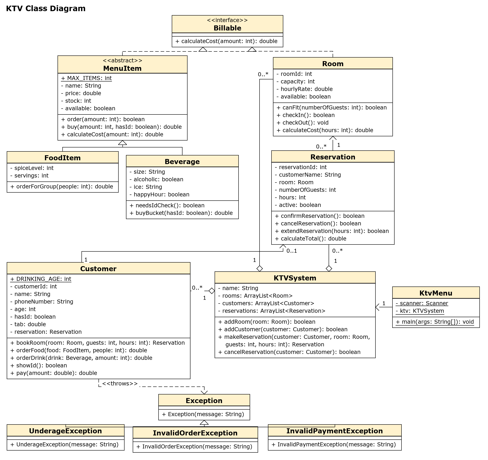

# KTV

SJSU CS 151 Section 5, Fall 2026. Project 2 group repository.

Due Saturday, October 24, 2026, at 11:59 PM.

## Overview

KTV is a Java program that simulates a karaoke bar. A user can create objects, connect them, change them through methods, and display their state. Each launch starts fresh. The program does not save data between runs.

The system allows at most 100 instances of each class. Creating an object that matches one that already exists is rejected. Going past the cap prints an error and leaves the program running.

The code covers the food and drink menu, rooms, reservations, customers, the KTV system, and a text menu that connects them.

## Developers

| Name | GitHub | Ownership |
| --- | --- | --- |
| Volodymyr Surin | [hellowworld-ctrl](https://github.com/hellowworld-ctrl) | `MenuItem`, `FoodItem`, `Beverage`, `Customer`, `KTVSystem`, `KtvMenu`, and this README |
| Thet Noe (Sky) | [galatic-milkshake](https://github.com/galatic-milkshake) | `Room` and `Reservation` |

## Design

`MenuItem` is the abstract parent of `FoodItem` and `Beverage`. Food and drinks share a name, price, and stock. Alcoholic drinks need an ID check. Bulk orders and happy hour change the price of that order only.

`Room` keeps a room id, capacity, hourly rate, and whether the room is open. `Reservation` ties a customer name to one room, with a guest count and a number of hours. A reservation can be confirmed, cancelled, or extended, and it can calculate the room cost.

`Customer` books a room through a `Reservation`, keeps a tab, and pays it down. Ordering alcohol requires the customer to be 21 or older and to have shown an ID. Customers under 21 can still book a room and order a non-alcoholic drink.

`KTVSystem` holds the rooms, customers, and reservations for one karaoke bar. It adds a room or a customer, books a room, and cancels a reservation.

`KtvMenu` in the `ui` package is the text menu. It is the only place that reads input. The main menu leads to customer, food, drink, room, and reservation choices. Typing `EXIT` in all caps at any prompt quits and thanks the user.

`MenuItem` and `Room` implement the `Billable` interface. Updated class diagram:



## Installation Instructions

Install a JDK (17 or newer). Then clone the repository:

```bash
git clone https://github.com/hellowworld-ctrl/KTV-CS151-Fall-2026.git
cd KTV-CS151-Fall-2026
```

Compile from the project root:

```bash
javac -d out src/menu/*.java src/reservation/*.java src/customer/*.java src/ktv/*.java src/ui/*.java
```

## Usage

Run the text menu from the project root:

```bash
java -cp out ui.KtvMenu
```

Choice 6 on the main menu prints goodbye. `EXIT` in all caps works at any prompt.

`FoodItem` also has a small demo that prints the starter food and drinks and places a few sample orders:

```bash
java -cp out menu.FoodItem
```

`Room`, `Reservation`, `Customer`, and `KTVSystem` do not have their own `main`.

## Contributions

- **Volodymyr Surin:** Added this README. Added `MenuItem`, `FoodItem`, and `Beverage`, including bulk discounts and happy hour. Added `Customer`, including the tab and the 21+ check for alcohol. Added `KTVSystem` and `KtvMenu`, including the all-caps `EXIT` quit.
- **Thet Noe (Sky):** Added `Room` and `Reservation`. A room stores its capacity, hourly rate, and availability, and it can check guests in and out. A reservation stores the customer name, room, guest count, and hours, and it can confirm, cancel, or extend the booking and calculate the room cost.
